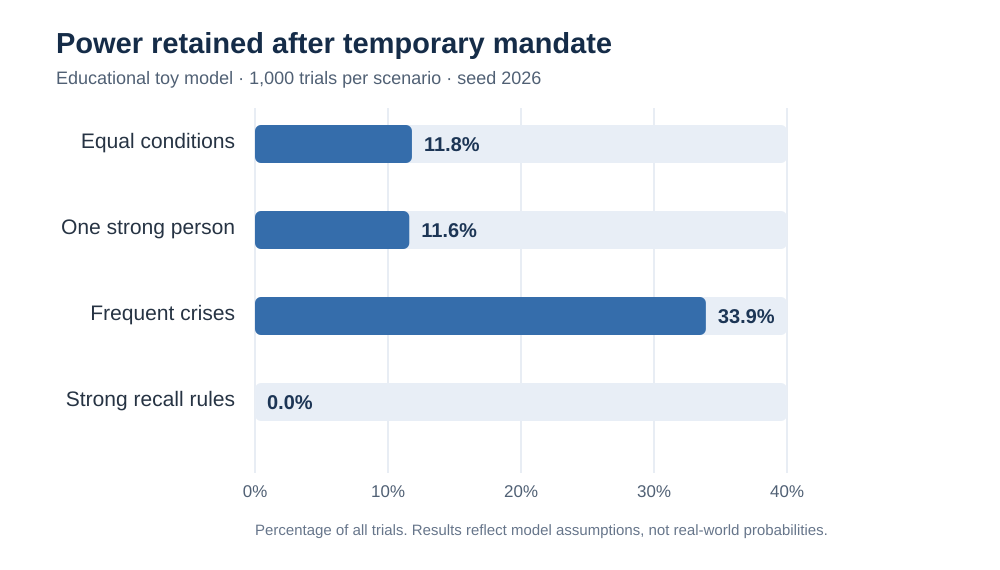

# 100人の村：リーダー創発と権力固定化のシミュレーション

An educational agent-based **toy model** of leadership emergence and retention of power in a 100-person village.

100人が最初は同じ身体能力・地位・資産を持つ村を仮定し、自発的な提案への支持からリーダーが生まれるか、その後の一時的な権限委譲が任期後の権力維持につながるかを調べます。

> **重要**：これは理論的な仕組みを試すための教育用モデルです。行動ルールや係数は仮定したものであり、現実世界の独裁・政治暴力・政権交代の確率を推定したものではありません。

## 結果

固定乱数シード `2026`、各シナリオ `1,000` 試行の結果です。

| シナリオ | リーダー誕生率 | 身体能力3倍の人が選ばれた率 | 任期後に権力を保持した率 |
|:--|--:|--:|--:|
| 全員平等・危機少 | 54.7% | 0.0% | 11.8% |
| 1人だけ身体能力3倍 | 65.8% | 20.6% | 11.6% |
| 危機が頻発 | 57.3% | 0.0% | 33.9% |
| 強い解任制度 | 56.0% | 0.0% | 0.0% |

「任期後に権力を保持した率」の分母は**全試行数**です。リーダーが誕生しなかった試行も含まれます。`0.0%` は今回の1,000回では0件だったという意味であり、発生が不可能という意味ではありません。



## 動作環境と再現方法

Python 3.10 以降を想定しています。

```bash
python -m pip install -r requirements.txt
python village_power_sim.py --runs 1000 --seed 2026 --output-dir results
```

これにより、次の2ファイルが生成・更新されます。

- `results/village_results.csv` — シナリオ別の結果（割合）
- `results/village_power_chart.svg` — 権力保持率のグラフ

## モデルのルール

1. **100人が出発**：全員の身体能力を1とする（比較条件では1人だけ3）。資産や地位の格差はモデル化しない。
2. **提案と支持**：各人にランダムな「提案の目立ちやすさ」と、他者からの評価ノイズを与える。10人以上に最も支持された候補がリーダーになる。
3. **期限付き委任**：リーダーは12期間、共同資源を管理する。危機が発生すると追加の資源が管理下に入るという仮定を置く。
4. **支持者の獲得**：管理資源と解任制度の強さに応じて報酬の申し出が行われ、支持者が生まれる。
5. **任期満了**：リーダーが居座りを試みる可能性と、反対派が公開で集まれる可能性をそれぞれ計算する。
6. **結果判定**：反対派の人数が支持者の人数を上回れば解任、そうでなければ権力保持とする。

これらのルールは**実証的に校正されていません**。とくに危機と資源、資源と支持、制度と抗議の関係はプログラムに初めから設定されているため、今回の結果をもってそれらの関係を発見・実証したとは言えません。

## 主要パラメータ

| 項目 | 説明 | 初期値 |
|:--|:--|:--|
| `N_PEOPLE` | 村人の数 | 100 |
| `TERM` | 委任期間 | 12 |
| `crisis_rate` | 各期間の危機発生確率 | 0.12 または 0.65 |
| `recall` | 解任・情報共有制度の強さ（0〜1） | 0.05 または 0.80 |
| `strong_person` | 1人だけ身体能力を3倍にするか | False または True |
| `--runs` | シナリオあたりの試行回数 | 1000 |
| `--seed` | 乱数シード | 2026 |

各シナリオで使用する乱数シードは `seed + 10000 * scenario_index` です。再現性を保つため、NumPy の乱数生成器を用いています。

## ファイル構成

```text
village_power_sim.py
requirements.txt
README.md
results/
  village_results.csv
  village_power_chart.svg
.gitignore
```

## 公開時の注意

このモデルは、現実の個人・国家に関する予測ツールではありません。結果の引用時には必ず条件・試行回数・仮定を併記してください。